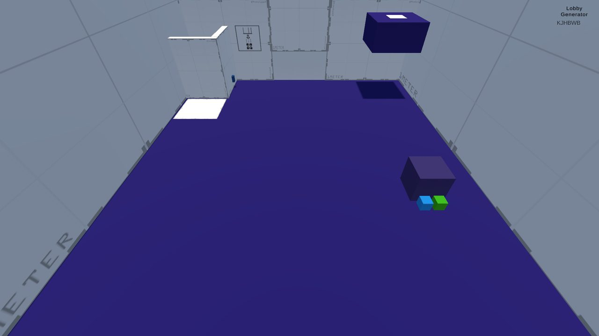
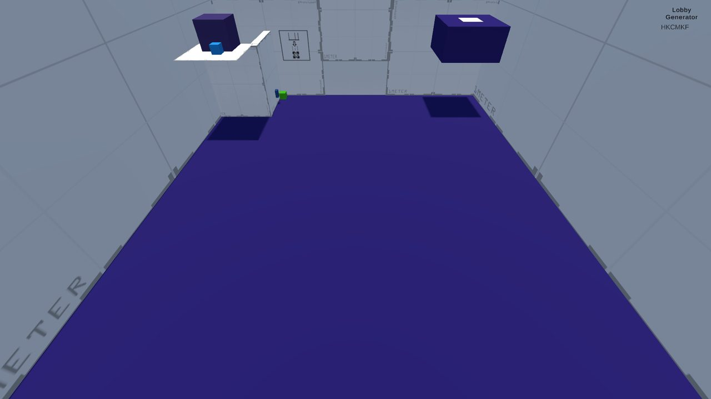
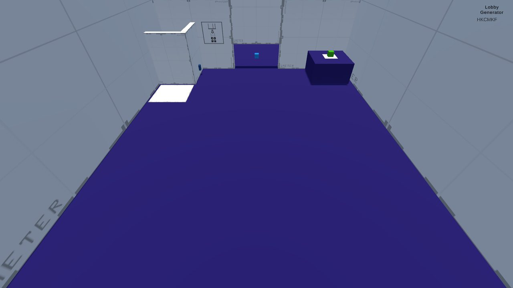

# TFG Prototype 2 · Planning and cooperation with the environment

Online 2-player co-op prototype built in **Unity (C#) with Netcode for GameObjects and Unity Relay**.
It is the second of three prototypes from my Final Degree Project at Universitat Pompeu Fabra (2024–2025, grade 9/10):

> _Análisis de los mecanismos en videojuegos multijugador y su impacto en la tipología de cooperación_
> (Analysis of mechanics in multiplayer video games and their impact on the type of cooperation)

The thesis analyses 44 small-scale co-op games, defines three types of cooperation (**communication**,
**planning** and **coordination**) and the mechanics that encourage each one, and validates them with
three playable prototypes and a user study with 20 participants (10 pairs).

## What this prototype tests

Focus: **planning** and **communication** to modify the environment and escape the room.

- A pressure plate that opens the exit sits on top of a block that is out of reach at first.
- Players push a cube (faster if both push together) into an elevator: one presses the button, the other rides up with the cube and pushes it onto a hidden pressure plate.
- That lowers the block, and one player climbs on top of the other to reach the plate and open the door for both.
- The characters are asymmetric: the green one cannot push the cube and is too heavy to ride the elevator with it, while the blue one can do both.

| Taking the cube up to the hidden plate | Block lowered: one player opens the door |
| --- | --- |
|  |  |

## Controls

| Action | Input |
| --- | --- |
| Move | WASD / arrow keys |
| Sprint | Left Shift |
| Jump | Space |

## Running it

1. Open the project with **Unity 2022.3.29f1**.
2. Link it to your own Unity Gaming Services project (Edit → Project Settings → Services) and enable **Relay**: the original project ID belongs to my account.
3. Open the `Game2` scene and press Play. One player hosts and gets a **join code**; the other enters it to join.
4. To test both players on one machine, the project includes **ParrelSync** to open a clone of the editor.

## The other prototypes

- [Prototype 1 · Communication and immediate coordination](https://github.com/Catcrac/TFG_Prototype_1)
- [Prototype 3 · Synergy and complex strategy](https://github.com/Catcrac/TFG_Prototype_3)

## License

[MIT](LICENSE)
